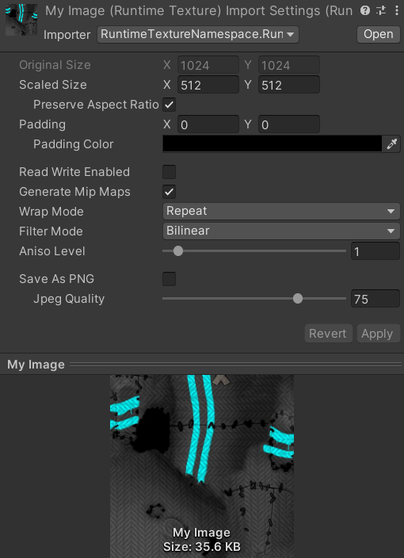
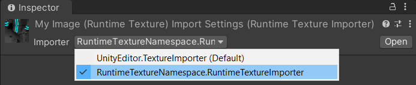

# Unity Runtime Texture

This asset is an abstraction layer on top of `Texture2D.LoadImage` to create **Texture2D** objects at runtime from raw *PNG/JPEG* data. Image files' contents are stored in **RuntimeTexture** assets and are used to create Texture2Ds on demand. With this abstraction layer, you no longer need to store the image files in e.g. *StreamingAssets* directory, you can hold references to RuntimeTexture assets in your scripts and generate Texture2Ds using them.

#### Pros

- Smaller build sizes since raw PNG/JPEG images are usually much smaller than uncompressed Texture2Ds
- No need to store image files in StreamingAssets folder or load them manually using Texture2D.LoadImage
- RuntimeTextures can be resized from the Inspector. Note that resized image's bytes will be calculated using *Texture2D.EncodeToPNG* or *Texture2D.EncodeToJPG*, resizing the image in e.g. Photoshop will probably produce a smaller image file

#### Cons

- Generated Texture2Ds will be uncompressed and thus, at runtime, will consume more memory compared to compressed Texture2Ds. Hence, RuntimeTexture is mostly useful for replacing already uncompressed Textures (like images in drawing games)

**Discord:** https://discord.gg/UJJt549AaV

**[GitHub Sponsors ☕](https://github.com/sponsors/yasirkula)**

## INSTALLATION

There are 4 ways to install this plugin:

- import [RuntimeTexture.unitypackage](https://github.com/yasirkula/UnityRuntimeTexture/releases) via *Assets-Import Package*
- clone/[download](https://github.com/yasirkula/UnityRuntimeTexture/archive/master.zip) this repository and move the *Plugins* folder to your Unity project's *Assets* folder
- *(via Package Manager)* click the + button and install the package from the following git URL:
  - `https://github.com/yasirkula/UnityRuntimeTexture.git`
- *(via [OpenUPM](https://openupm.com))* after installing [openupm-cli](https://github.com/openupm/openupm-cli), run the following command:
  - `openupm add com.yasirkula.runtimetexture`

## HOW TO

To create a **RuntimeTexture** asset, simply select a PNG/JPEG asset and from the Inspector header, set the Importer to *RuntimeTextureNamespace.RuntimeTextureImporter*:

To get a Texture2D from a RuntimeTexture asset, call its `Texture` property. The first call will initialize the Texture2D using `Texture2D.LoadImage`. Later calls will simply return that existing Texture2D. Note that the returned Texture2D isn't unloaded automatically, so you need to call `runtimeTexture.DestroyTexture()` to unload it manually when you no longer need it!
